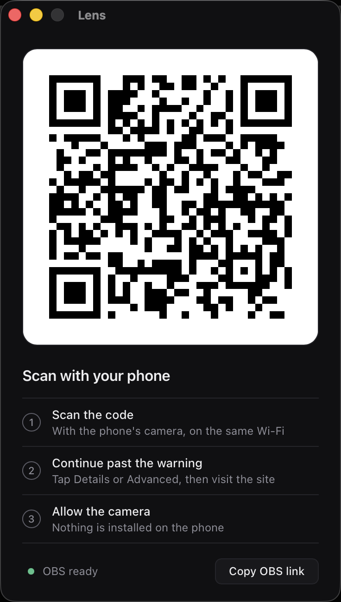

# Lens

Scan a QR code and your phone becomes a camera in OBS. Nothing to install on the phone.



## Download

| Your computer | Download | The first time you open it |
|---|---|---|
| Mac | [Lens for Mac](https://github.com/GH-Jaider/lens/releases/latest/download/Lens-macOS.dmg) | macOS blocks it once, because Lens is not signed with an Apple account. Open **System Settings → Privacy & Security** and choose **Open Anyway**. |
| Windows | [Lens for Windows](https://github.com/GH-Jaider/lens/releases/latest/download/Lens-Windows.exe) | Windows warns about an unknown publisher. Choose **More info → Run anyway**, and allow Lens through the firewall when asked. |
| Linux | [AppImage](https://github.com/GH-Jaider/lens/releases/latest/download/Lens-Linux.AppImage) or [.deb](https://github.com/GH-Jaider/lens/releases/latest/download/Lens-Linux.deb) | Make the AppImage executable and run it. |

Lens tells you in its window when a newer version is out and installs it when you ask.

## How it works

1. Open Lens on the computer. It shows a QR code.
2. Scan it with the phone, on the same Wi‑Fi. The phone warns once that the connection is not private, because the certificate is Lens's own and not from a public authority; choose to continue and allow the camera.
3. If OBS is open, Lens adds a source named **Lens** to the current scene and turns on the virtual camera, so Zoom, Meet or Discord see the phone as **OBS Virtual Camera**.

Closing the window leaves Lens in the menu bar or tray; Quit is in its menu.

The video goes straight from the phone to OBS over the local network (WebRTC). Lens only introduces the two, and nothing leaves your network.

### Picture

The phone sends 1080p at 30 frames per second unless told otherwise, and as much of it as the Wi‑Fi carries. A strip along the bottom of the phone shows the camera's settings and their values, as a camera does; touch one to change it. Every phone has resolution, frame rate and quality, plus whatever else its browser can set: Android phones usually offer zoom, light, shutter, ISO, white balance and focus, and iPhones offer fewer. Where the browser can only hold a setting still, not choose its value, the choice is Auto or Locked. Beside **Live**, the phone shows what is really being sent.

The eye on the preview in the Lens window turns the preview off; OBS keeps the picture.

### OBS

Lens reads OBS's own WebSocket settings, so there is no password to copy. The WebSocket server has to be on: in OBS, **Tools → WebSocket Server Settings**.

The first time Lens adds its source to a running OBS on a Mac, OBS shows nothing until it is opened again; Lens says so in its window. After that the source is part of your scenes and it does not happen again.

Without the WebSocket server, use **Copy OBS link** in Lens and add it by hand as a **Browser** source.

### Linux

- The virtual camera in OBS needs the `v4l2loopback` kernel module.
- On desktops without a tray, closing the window quits Lens.
- Some distributions ship a web view without WebRTC. The window then cannot preview the picture, but OBS still receives it.

## Build

Needs Rust, Node 22.18+, pnpm and, on Linux, the [Tauri system libraries](https://tauri.app/start/prerequisites/).

```sh
pnpm install
pnpm app         # installers in target/release/bundle
cargo run        # development
```

## Test

```sh
pnpm check       # types, linters and tests
pnpm test        # only the tests
```

The pages and the tests are TypeScript, checked by `tsc` and Biome; the Rust is checked by clippy and rustfmt. `pnpm fix` applies the formatting.

The tests start Lens without its window and drive a headless Chrome whose camera is a test pattern, as both the phone and OBS; then they start the real app. CI runs this on macOS, Windows and Linux.

## Release

Set the same version in `Cargo.toml` and `tauri.conf.json`, then push a tag (`git tag v0.2.0 && git push --tags`). The Release workflow builds every installer into a draft release; publishing the draft is what offers the update to everyone. Updates are signed with the key in the repository secrets `TAURI_SIGNING_PRIVATE_KEY` and `TAURI_SIGNING_PRIVATE_KEY_PASSWORD`; without that same key, installed copies refuse the update.

## Layout

| Path | What |
|---|---|
| `src/server.rs` | The two listeners: local HTTP for the app and OBS, HTTPS for the phone |
| `src/hub.rs` | Relays the WebRTC handshake between the phone and its viewers |
| `src/obs.rs` | OBS WebSocket client: adds the source, starts the virtual camera |
| `src/tls.rs` | The self-signed certificate, kept per network address |
| `src/main.rs` | Window, tray, updates, `--headless` |
| `web/` | The app window, the phone page and the page OBS loads; their TypeScript is in `web/src` |
| `tests/` | End to end, with a headless Chrome as the phone and as OBS |

## License

Apache-2.0
